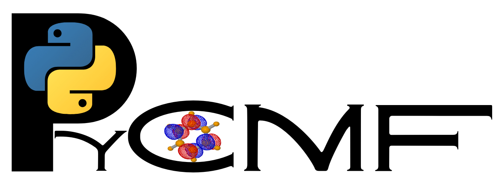

<div align="left">
  
</div>

# pyCMF

pyCMF is a Python package of **correlated mean-field methods** built on
[PySCF](https://pyscf.org). Its core is one-body second-order Møller–Plesset
perturbation theory (OBMP2): the Hartree–Fock Fock operator is replaced by a
correlated Fock operator that contains a one-body MP2 correlation potential,
and the orbitals, orbital energies and amplitudes are iterated to
self-consistency at the cost of one MP2 calculation per cycle.

| Method | What it is | Entry point | Status |
| --- | --- | --- | --- |
| OBMP2 | self-consistent one-body MP2, restricted and unrestricted | `pycmf.OBMP2` | stable |
| O2BMP2 | OBMP2 with scaled opposite-spin amplitudes only | `pycmf.O2BMP2` | stable |
| OBDH | one-body double hybrid: Kohn–Sham Fock + scaled OBMP2 potential; B2PLYP and other double hybrids by name | `pycmf.OBDH` | stable |
| O2BDH | OBDH with scaled opposite-spin amplitudes only | `pycmf.O2BDH` | stable |
| OBDF | one-body downfolding to an active-space Hamiltonian | `pycmf.OBDF` | stable |
| state-specific excited states | any of the first four with `occupation='mom'` or `'imom'` | keyword | stable |
| RO-OBMP2 | restricted open-shell OBMP2 | `pycmf.mol.roobmp2.ROOBMP2` | experimental |
| embedding | OBMP2- and OBDH-in-DFT projection embedding (separate functionals for subsystem and environment), concentric localization | `pycmf.embed` | experimental |
| k-point OBMP2, O2BMP2 | periodic systems, closed shell: density fitting, k-point symmetry, MPI | `pycmf.pbc.KOBMP2`, `KO2BMP2` | experimental |
| k-point OBDF | downfolding to active bands on the integrals of KOBMP2; mean field, second-order quasiparticles and supercell solvers of the model | `pycmf.pbc.KOBDF` | experimental |
| k-point unrestricted OBMP2 | periodic systems (code of version 0.2) | `pycmf.pbc.KUOBMP2` | experimental |

"Stable" methods are covered by the test suite and exported at the top level.
"Experimental" methods are under development: they are imported from their
sub-package, emit an `ExperimentalWarning`, and are documented in
[docs/status.md](docs/status.md).

## Installation

pyCMF needs Python ≥ 3.9, NumPy, SciPy and PySCF ≥ 2.10.

```bash
git clone https://github.com/QuantumLab-HCMUS/pyCMF.git
cd pyCMF
pip install .            # or: pip install -e ".[dev]" for development
```

## Quick start

```python
from pyscf import gto, scf
import pycmf

mol = gto.M(atom='O 0 0 0; H 0 0 0.97', basis='cc-pvdz', spin=1)
mf = scf.UHF(mol).run()

mp = pycmf.OBMP2(mf).run()                 # restricted or unrestricted, chosen from mf
print(mp.e_tot, mp.spin_square())

o2 = pycmf.O2BMP2(mf, c_os=1.2).run()      # c_os has no default

mf_df = scf.UHF(mol).density_fit().run()
dh = pycmf.OBDH(mf_df).run()               # B2PLYP by default; xc='PBE0-DH', ...

ham = pycmf.OBDF(mp, ncas=5, nelecas=(3, 2))    # active-space Hamiltonian
e_tot = ham.kernel()                             # FCI in the active space
h1, e_core = ham.get_h1eff()
h2 = ham.get_h2eff()
```

Density fitting is used automatically when the mean-field object uses it, or
on request with `pycmf.OBMP2(mf).density_fit()`. Excited states are computed
state-specifically from a non-Aufbau determinant:

```python
ex = pycmf.O2BMP2(mf_mom, c_os=1.2, occupation='imom').run()
omega = ex.e_tot - o2.e_tot
```

More in [docs/usage.md](docs/usage.md) and in the scripts of
[examples/](examples); the theory is summarised in
[docs/theory.md](docs/theory.md).

## Testing

```bash
pip install ".[test]"
pytest -m "not slow"     # 105 tests, about two minutes on a laptop
pytest                   # adds the slower k-point tests (symmetry, MPI; a few minutes)
```

The tests compare with conventional MP2 and FCI limits from PySCF and with
reference energies of the previous implementation of the methods; see
[docs/validation.md](docs/validation.md). Each example in `examples/` has its
expected output in `examples/reference_output/`.

## Repository layout

```
src/pycmf/
  core/        self-consistent driver, DIIS, occupation schemes (Aufbau/MOM), amplitudes
  mol/         molecules: integrals, correlation potential, OBMP2, O2BMP2, OBDH, O2BDH, RO-OBMP2
  downfold/    one-body downfolding, FCIDUMP export
  properties/  densities, dipole moments, <S^2>, hyperfine couplings
  embed/       projection embedding and concentric localization   (experimental)
  pbc/         k-point OBMP2, O2BMP2 and OBDF                       (experimental)
tests/         pytest suite
examples/      runnable scripts with reference output
benchmarks/    timing script; legacy inputs of version 0.2
docs/          theory, usage, validation, status, migration from version 0.2
paper/         material for the Computer Physics Communications submission
```

## Citing

If you use pyCMF, please cite the papers of the methods you use
(see [CITATION.cff](CITATION.cff) and [docs/theory.md](docs/theory.md)):

- OBMP2: T. N. Lan and T. Yanai, *J. Chem. Phys.* **138**, 224108 (2013);
  L. N. Tran, *J. Phys. Chem. A* **125**, 9242 (2021)
- densities: L. N. Tran, *Phys. Chem. Chem. Phys.* **24**, 19393 (2022)
- O2BMP2: N. T. Tran, H. T. Nguyen and L. N. Tran, *J. Phys. Chem. A* **128**, 1543 (2024)
- state-specific excited states: N. T. Tran and L. N. Tran, *J. Chem. Phys.* **162**, 104109 (2025)
- downfolding: N. T. Le and L. N. Tran, *J. Phys. Chem. A* **127**, 5222 (2023)

and PySCF: Q. Sun *et al.*, *WIREs Comput. Mol. Sci.* **8**, e1340 (2018).

## License

Apache License 2.0, see [LICENSE](LICENSE) and [NOTICE](NOTICE).

pyCMF is developed by QuantumLab HCMUS, University of Science, Vietnam
National University Ho Chi Minh City.
